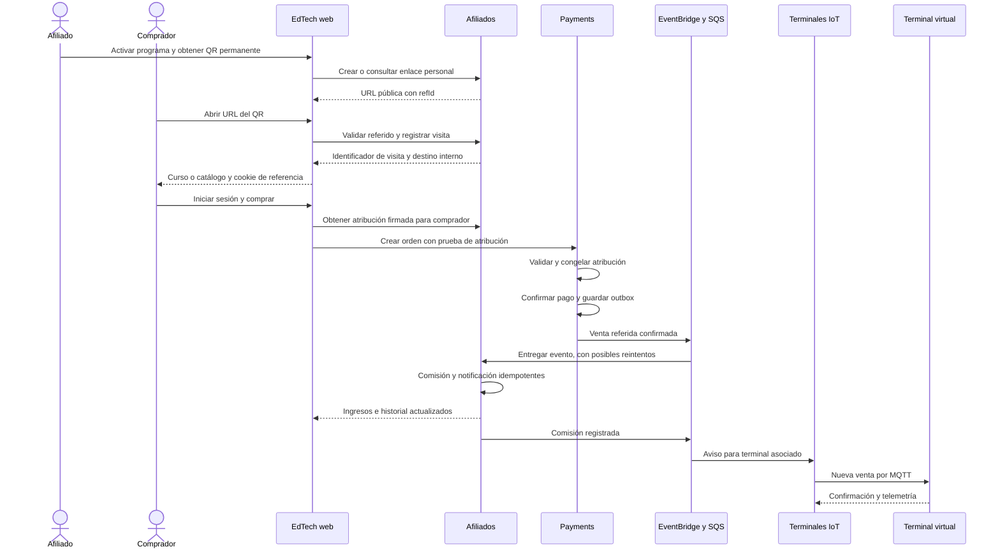
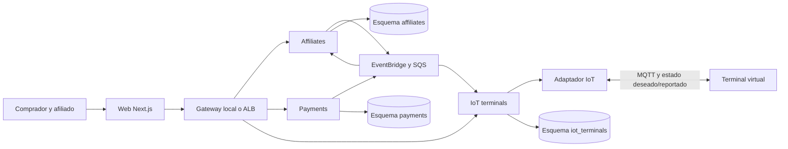

# Plan de integración: afiliados, QR permanente y terminal IoT

Fecha: 7 de octubre de 2026. Estado: recorrido local implementado y verificado. La fase AWS permanece pendiente; las secciones de infraestructura cloud describen el trabajo posterior y no recursos ya desplegados. Guía operativa y resultados: [afiliados-iot-local.md](afiliados-iot-local.md).

Alcance ajustado para el proyecto de curso de UNI: el recorrido del afiliado termina en una notificación y en la consulta de sus **Ingresos**. Se excluyen retiros, liquidaciones, transferencias, cuentas bancarias y pagos al afiliado. «Ingresos» representa las comisiones contabilizadas por ventas referidas, no dinero transferido.

## 1. Resultado esperado y alcance

Una persona inicia sesión en EdTech, activa su participación como afiliado y obtiene un QR permanente con su enlace personal. Otra persona abre ese enlace, consulta un curso y compra. Después de confirmar el pago, EdTech registra una comisión del 5%, actualiza la sección **Ingresos** del afiliado y genera una notificación. Si el afiliado tiene un terminal promocional, este recibe un aviso de nueva venta.

El terminal se implementará primero como un dispositivo virtual ejecutado en Docker. Posteriormente, el mismo simulador podrá ejecutarse en AWS y conectarse a AWS IoT Core. La pantalla web permite visualizarlo y configurarlo; el proceso del simulador es el dispositivo conectado.

**Sí se puede desarrollar y demostrar este recorrido localmente sin credenciales de AWS.** La infraestructura de destino se preparará con Terraform. Para el primer despliegue hacen falta también publicar las imágenes, preparar la base de datos, suministrar secretos y verificar la cuenta. El objetivo será automatizar esos pasos en un comando de despliegue, que coordine varios `terraform apply`; un `apply` aislado no cubre el recorrido actual del proyecto.

### Incluido en la primera versión

- QR personal permanente, enlace copiable y descarga del QR.
- Atribución de visitas y de compras, conservada durante registro e inicio de sesión.
- Comisión del 5%, total de ingresos, historial por venta y notificación dentro de EdTech.
- Reembolsos, protección contra duplicados y bloqueo de autorreferidos.
- Administración de afiliados, comisiones y terminales.
- Terminal virtual: QR, mensaje promocional, conexión, configuración remota y aviso de venta.
- Entorno local reproducible, Terraform, CI y procedimiento de despliegue y recuperación.

### Extensiones posteriores

Múltiples monedas, campañas avanzadas, correo o notificaciones al teléfono, dispositivo físico y analítica externa. El primer alcance no necesita Google Cloud. Un ingreso opcional con Google se trataría como una integración de identidad independiente.

## 2. Base existente y cambios necesarios

La revisión se realizó sobre los archivos actuales, incluyendo modificaciones locales existentes. No se ejecutaron llamadas a AWS ni se volvió a levantar la plataforma durante esta planificación. La evidencia de Docker/WSL disponible en documentación corresponde a pruebas previas.

| Base actual                                                      | Uso en esta integración                                       | Trabajo pendiente                                            |
| ---------------------------------------------------------------- | ------------------------------------------------------------- | ------------------------------------------------------------ |
| Monorepo Bun y seis servicios con arquitectura por capas         | Conservar separación de dominio, aplicación e infraestructura | Añadir contextos, contratos y controles de arquitectura      |
| Next.js 15, App Router y diseño EdTech definido                  | Crear vistas dentro de la aplicación actual                   | Rutas, acciones del servidor, permisos y estados de interfaz |
| `payments`, precios proyectados, confirmación y reembolso        | Fuente de verdad para la venta                                | Capturar atribución en la orden y publicar venta referida    |
| Postgres 16 local y Aurora en destino                            | Libro de comisiones y estado de terminales                    | Esquemas, roles, migraciones e índices                       |
| EventBridge, SQS y DLQ                                           | Separar pago, comisión y señal del dispositivo                | Ampliar `tools/eventos.json` y consumidores                  |
| LocalStack 3; servicios locales events, sqs, s3 y secretsmanager | Mantener el entorno AWS simulado existente                    | Incorporar MQTT y puente local para Shadow/Rules             |
| Autenticación local y Cognito en AWS                             | Identidad de comprador, afiliado y administrador              | Autorización de recursos y continuidad de atribución         |
| Terraform por entorno y por servicio, ECS Fargate y ECR          | Desplegar infraestructura y contenedores                      | IoT, nuevos servicios y trabajador del simulador             |
| Docker Compose y override de Anrrous Dev                         | Pago simulado y demostración local                            | Nuevo perfil, configuración de URL y datos de demostración   |

Hallazgos que condicionan el primer despliegue:

1. `infra/modules/database/main.tf` consulta un clúster Aurora existente: actualmente no lo crea. Hay scripts separados de creación y bootstrap. El clúster debe existir antes de evaluar esa consulta; el orquestador debe respetar esta dependencia.
2. Hay referencias de cuenta y bucket del estado remoto incorporadas en Terraform. Deben parametrizarse si la cuenta futura no coincide con la configurada.
3. `tools/aws/desplegar-servicio.sh` construye y publica imágenes antes de aplicar el estado del servicio. Solo distingue `web` de los servicios actuales; deberá reconocer el simulador.
4. El módulo de servicio asume un servicio HTTP detrás del ALB. El simulador MQTT necesita un módulo de trabajador sin ALB, con una sola instancia por identidad de terminal.
5. La existencia de una cola `notifications` no demuestra que ya exista una notificación de comisión en la interfaz. Se implementará y verificará expresamente.
6. Los listados de servicios, esquemas y trabajos de CI son explícitos. Deben ampliarse junto con el código, sin eludir los controles del repositorio.

## 3. Reglas de negocio

| Regla                 | Definición                                                                                                       |
| --------------------- | ---------------------------------------------------------------------------------------------------------------- |
| Afiliación            | Cualquier usuario autenticado habilitado puede activar el programa; conserva su acceso como estudiante           |
| QR                    | Permanente; contiene una URL pública con identificador aleatorio del afiliado, sin contraseña ni token de sesión |
| Comisión              | 5% de la base elegible efectivamente pagada; USD 40 → USD 2; USD 20 → USD 1                                      |
| Confirmación          | El retorno del navegador y el escaneo no acreditan una compra; se requiere confirmación válida de `payments`     |
| Duplicados            | Una acreditación inicial por orden; un evento repetido no vuelve a acreditar ni notificar                        |
| Autorreferido         | Comprador y afiliado no pueden ser el mismo usuario                                                              |
| Reembolso             | Recalcula el derecho a comisión y registra ajustes; no borra el historial                                        |
| Moneda                | Primera versión en USD; impedir sumar monedas distintas en el total de ingresos                                  |
| Ingresos              | Suma de comisiones registradas menos ajustes por reembolso; actualización al confirmar la venta                  |
| Terminal desconectado | No afecta el pago ni la acreditación; su aviso puede recuperarse al reconectar                                   |

Decisiones propuestas para implementar como configuración, pendientes de ratificar al iniciar la construcción:

- Último referido válido dentro de 30 días. La selección se congela al crear la orden; reutilizar una orden pendiente no cambia a su afiliado.
- Base elegible: importe del curso después de descuentos, excluyendo impuestos y conceptos separados. `payments` debe aportar esa base explícitamente; no inferirla de un total que incluya otros conceptos.

Comportamiento definido para el alcance académico:

- Sin período de espera: la comisión aparece en **Ingresos** cuando se procesa el pago confirmado.
- Aviso inmediato: «¡Nueva venta! Obtuviste USD 2,00 de comisión». Al abrirlo, el afiliado ve la venta y el cálculo del 5%.
- En la demo local las compras son simuladas y la interfaz lo identifica; los importes mostrados son registros del proyecto.

Cada orden conservará la versión de las reglas aplicada. Una modificación futura del porcentaje no cambia compras anteriores.

## 4. Recorrido exacto del QR y de la venta

Ejemplo de URL: `https://<dominio-edtech>/r/<refId>`. Para una promoción de curso se puede añadir un identificador de campaña registrado; los destinos aceptados se limitan a páginas internas de EdTech.

| Paso | Actor y acción                              | Información y resultado                                                                                                             |
| ---- | ------------------------------------------- | ----------------------------------------------------------------------------------------------------------------------------------- |
| 1    | Afiliado inicia sesión y activa el programa | Se crea un registro único asociado a su identidad; recibe su URL y QR                                                               |
| 2    | Afiliado comparte el QR o el enlace         | No cambia su identificador; ambos llevan al mismo recorrido                                                                         |
| 3    | Visitante abre `/r/<refId>`                 | El servidor valida que el afiliado esté activo y registra una visita elegible                                                       |
| 4    | Servidor conserva la referencia             | Genera un identificador opaco de visita y una cookie propia; evita incluir datos personales del afiliado en el navegador            |
| 5    | EdTech presenta el destino                  | Curso seleccionado: título, contenido, precio y botón de compra; si no hay curso, catálogo con explicación de la promoción          |
| 6    | Visitante se registra o inicia sesión       | La referencia se conserva a través de los redirects; se vincula a la identidad del comprador                                        |
| 7    | Comprador inicia checkout                   | El servidor obtiene una prueba firmada de atribución válida, vinculada al comprador y con vencimiento                               |
| 8    | `payments` crea la orden                    | Valida la prueba y guarda afiliado, visita, reglas y base elegible; nunca confía en un `affiliateId` libre enviado por el navegador |
| 9    | Proveedor confirma el pago                  | `payments` persiste el resultado y un evento de venta referida mediante outbox transaccional                                        |
| 10   | Afiliados consume el evento                 | En una transacción registra el evento procesado, la comisión y la notificación pendiente de entrega                                 |
| 11   | Afiliado consulta su panel                  | Ve USD 2,00 en Ingresos, la venta y la notificación; no ve datos privados del comprador                                             |
| 12   | Integración IoT recibe la nueva comisión    | Si existe terminal asociado, envía un aviso público de «Nueva venta» con identificador deduplicable                                 |

Un enlace inválido o un afiliado suspendido permite continuar al catálogo sin atribución y con un mensaje adecuado. Si falla temporalmente el registro de atribución, se mantiene el acceso al catálogo, se explica que la referencia no pudo guardarse y se permite reintentar; no se anuncia una atribución que no quedó registrada.

### Secuencia de compra

La atribución entre navegadores o dispositivos distintos no queda resuelta por una cookie. En la primera versión se conserva una referencia ya vinculada a la cuenta del comprador; antes de iniciar sesión no se promete seguimiento entre dispositivos.

Tampoco se puede distinguir técnicamente un escaneo de QR de un clic sobre su misma URL. La métrica se llamará **visitas desde el enlace del afiliado**. Si se necesita separar canales, se crearán enlaces de campaña distintos, todos asociados al mismo afiliado.

## 5. Vistas y permisos

Rutas propuestas; se integrarán con los layouts existentes y con el sistema de diseño `design-system/edtech-skills/MASTER.md`.

| Vista                       | Contenido                                                                                        | Acciones y acceso                                                                                 |
| --------------------------- | ------------------------------------------------------------------------------------------------ | ------------------------------------------------------------------------------------------------- |
| `/afiliados`                | Explicación del 5%, reglas y estado de participación                                             | Activar programa; usuario autenticado                                                             |
| `/afiliados/qr`             | QR funcional, URL, vista previa del destino y curso promocionado                                 | Copiar, descargar PNG/SVG y compartir; propietario                                                |
| `/afiliados/panel`          | Visitas, ventas confirmadas, conversión y tarjeta **Ingresos** con total acumulado y del período | Filtrar fechas; propietario                                                                       |
| `/afiliados/ingresos`       | Fecha, curso, base de cálculo, porcentaje del 5%, ingreso por venta, estado y ajustes            | Consultar detalle e historial; propietario                                                        |
| `/afiliados/notificaciones` | Nuevas comisiones y cambios de estado                                                            | Marcar como leídas; propietario                                                                   |
| `/afiliados/terminal`       | Estado del terminal, última conexión, mensaje y curso                                            | Solicitar terminal, configurar el asignado y abrir vista previa; propietario                      |
| `/terminales/<id>/vista`    | QR permanente y promoción; aviso breve de nueva venta                                            | Presentación pública con acceso limitado y revocable; no muestra ingresos privados ni compradores |
| `/admin/afiliados`          | Actividad, afiliados y alertas de operación                                                      | Suspender/reactivar y revisar atribuciones; administrador                                         |
| `/admin/comisiones`         | Ventas referidas, comisiones registradas y ajustes por reembolso                                 | Consultar y verificar el cálculo; administrador                                                   |
| `/admin/terminales`         | Dispositivos, estado, configuración y fallas                                                     | Asociar, desactivar y revisar mensajes; administrador                                             |

Diseño: tarjetas blancas sobre fondo suave, tokens `--gs-*`, tipografías existentes, tablas contenidas y estados indicados con texto. Preservar Next.js 15 y componentes existentes; no cambiar de framework ni de identidad visual para esta funcionalidad.

Cada vista tendrá estados de carga, sin datos, error con reintento, permisos insuficientes y terminal desconectado. QR con URL alternativa visible, controles accesibles por teclado, foco visible y objetivos táctiles de al menos 44 px. Verificar anchos de 375, 768, 1024 y 1440 px.

Los endpoints comprueban propietario o administrador en el servidor. Una cuenta no puede consultar ingresos ajenos cambiando un ID. No se expondrán correos, nombres de compradores ni capturas del proveedor en vistas públicas.

## 6. Arquitectura propuesta

Dos nuevos contextos, sujetos a un ADR que actualice la decisión original de seis servicios:

- **`services/affiliates`**: afiliación, enlaces, visitas, atribución, registro de comisiones, consulta de ingresos y notificaciones dentro del programa.
- **`services/iot-terminals`**: registro lógico de terminales, asociación autorizada, configuración, telemetría, estado y entrega de avisos.
- **`apps/terminal-simulator`**: proceso del dispositivo virtual, conexión MQTT, configuración aplicada y confirmaciones. No calcula comisiones.

La web usa su capa de servidor y el gateway/ALB. Cada servicio mantiene sus tablas en su propio esquema y usa su propio rol de base de datos. No se permiten consultas ni imports internos entre servicios; la comunicación usa contratos HTTP definidos o eventos. Los títulos de cursos necesarios para lectura pueden mantenerse como proyección local desde eventos de catálogo.

### Contratos HTTP a definir

| Operación lógica                               | Responsabilidad                                                                                          |
| ---------------------------------------------- | -------------------------------------------------------------------------------------------------------- |
| Activar afiliación / consultar mi afiliación   | Alta idempotente y registro personal                                                                     |
| Resolver referido público y registrar visita   | Validar `refId`, deduplicar navegación básica y devolver destino interno                                 |
| Vincular visita / obtener prueba de atribución | Verificar sesión, vigencia y autorreferido; emitir prueba firmada para el comprador                      |
| Consultar resumen, ingresos y notificaciones   | Total de comisiones netas, historial filtrado y paginación por cursor; alcance exclusivo del propietario |
| Crear/configurar/desactivar terminal           | Comprobar propiedad, límites y versión de configuración                                                  |
| Consultar estado y vista previa de terminal    | Separar contenido público de administración privada                                                      |

Los paths internos, payloads, errores y esquemas JSON se fijarán en la fase 1 antes de escribir las interfaces. El registro de comisiones y las operaciones de configuración usarán identificadores de idempotencia o control de versión según corresponda.

### Modelo mínimo de datos

| Esquema         | Entidades propuestas                               | Restricciones e índices esenciales                                                                     |
| --------------- | -------------------------------------------------- | ------------------------------------------------------------------------------------------------------ |
| `affiliates`    | `affiliates`, `referral_links`                     | Usuario único; `refId` único; estado y fechas de alta                                                  |
| `affiliates`    | `referral_visits`, `buyer_attributions`            | Identificadores opacos; índices por afiliado/fecha y comprador/vigencia; expiración configurada        |
| `affiliates`    | `commissions`, `commission_movements`              | Acreditación original única por orden; movimientos inmutables; índices por afiliado/moneda/fecha       |
| `affiliates`    | `notifications`, `processed_events`, `outbox`      | Notificación por movimiento/tipo única; `event_id` único; índice de trabajos pendientes                |
| `payments`      | Atribución de orden y outbox                       | Snapshot de afiliado, visita, versión de reglas y base elegible; persistencia atómica con confirmación |
| `iot_terminals` | `terminals`, `terminal_configs`, `terminal_alerts` | Identidad de terminal única; propietario; versiones; alertas deduplicables y estado de entrega         |
| `iot_terminals` | `processed_events`, `outbox`                       | Reintentos sin repetir efectos; índices por dispositivo y fecha                                        |

Mantener el tipo de ID y las convenciones de Drizzle del repositorio. Usar centavos enteros para importes y 500 puntos básicos para el 5%; definir redondeo al centavo una sola vez. El total de ingresos se consulta agregando las comisiones y sus ajustes por afiliado, moneda y período; no requiere un saldo transaccional independiente. Las transacciones no incluirán llamadas a PayPal, MQTT ni AWS. El rol de cada servicio solo tendrá acceso a su esquema.

## 7. Eventos, comisiones y recuperación

Conservar `payments.pago-confirmado.v1` para los consumidores actuales. Proponer un contrato adicional `payments.venta-referida-confirmada.v1`, publicado solamente para una orden atribuida. Contendrá orden, comprador, afiliado, visita, curso, base elegible en centavos, moneda, captura, fecha y versión de política.

`affiliates` acredita desde ese evento específico, no desde ambos eventos de pago. Consumirá también el reembolso existente, resolviendo moneda y política desde la orden/comisión guardada. Un evento de dominio `affiliates.comision-registrada.v1` permitirá a terminales actualizar su proyección y preparar el aviso.

Actualizar la topología única en `tools/eventos.json`: colas de los nuevos servicios, DLQ, reglas, eventos de catálogo necesarios y cola interna de telemetría IoT. Regenerar el init local; no modificar Terraform y LocalStack como dos configuraciones independientes.

### Registro de ingresos

Al procesar una venta confirmada, la comisión queda **Registrada** y se suma inmediatamente a **Ingresos**. Si se reembolsa parte del curso, queda **Ajustada**; si se reembolsa todo, queda **Anulada**. Estos estados describen el registro de la venta referida.

Un reembolso genera un ajuste y recalcula la comisión sobre la base restante. El historial conserva el importe original y el ajuste; el total de ingresos muestra el neto. No se borra la venta original.

Controles obligatorios:

- Outbox transaccional en el camino financiero: caída entre persistencia y publicación no pierde la venta.
- Procesamiento idempotente por evento, orden y reembolso.
- Registro de movimientos como evidencia, con totales conciliables; no editar importes históricos silenciosamente.
- Reembolso recibido antes de la venta: conservarlo pendiente y reconciliar por orden.
- Reembolsos parciales: calcular el derecho sobre la base acumulada restante para evitar diferencias de redondeo por fragmentación.
- Notificación persistida con la comisión, entrega reintentable y lectura desde el panel. Los transportes pueden repetir mensajes: no se promete entrega de red exactamente una vez.
- Reprocesamiento de DLQ controlado, con auditoría y validación de esquema.

Ejemplo de consulta: curso de USD 40, comisión del 5%, ingreso registrado de USD 2. Al recibir un reembolso total, se registra un ajuste de −USD 2 y el ingreso neto de esa venta pasa a USD 0.

## 8. Qué hace el dispositivo IoT

El caso de uso es un **terminal promocional administrable**: útil en academias, eventos o puntos de atención. El afiliado puede ver si su promoción está operativa, cambiar el curso o el mensaje y recibir una señal cuando la plataforma confirma una venta.

| Función              | Comportamiento propuesto                                                              |
| -------------------- | ------------------------------------------------------------------------------------- |
| Identidad            | Un terminal registrado y asociado a un afiliado                                       |
| Presentación         | Mismo QR permanente; cambiar promoción no rota el identificador del afiliado          |
| Configuración remota | Mensaje, curso, habilitado y versión de configuración                                 |
| Estado reportado     | Versión aplicada, arranque, conexión y errores; sin datos del comprador               |
| Heartbeat            | Cada 30 s; mostrar desconectado después de 90 s sin telemetría, valores configurables |
| Nueva venta          | Aviso breve con `alertId`; confirmación y deduplicación                               |
| Reconexión           | Backoff, recuperación de configuración vigente y alertas pendientes no caducadas      |

El terminal no sabe cuándo alguien apunta una cámara al QR. La visita se registra al abrir la URL. El terminal tampoco certifica que una compra esté pagada: recibe un evento derivado de la comisión registrada.

### Contrato de comunicación

Topics propuestos: `edtech/dev/terminals/<deviceId>/telemetry`, `/ack` y `/alerts`. En AWS, estado remoto mediante Named Shadow `promotion`, con `desired` y `reported` y sus topics reservados `$aws/things/<thingName>/shadow/name/promotion/...`.

No publicar identidad del comprador, tokens de sesión, capturas ni ingresos privados en los topics o en el Shadow. Un aviso público solo necesita identificador y texto. La versión de configuración evita que mensajes atrasados sustituyan una configuración más nueva.

En AWS, el simulador utilizará MQTT sobre WebSocket seguro con firma SigV4 y credenciales temporales del rol de la tarea. Debe probarse la compatibilidad del cliente elegido con Bun y con renovación/reconexión. El servicio de terminales usará las APIs de IoT Data desde su adaptador de infraestructura.

Para un dispositivo físico futuro podría usarse certificado X.509 con un proceso específico de aprovisionamiento. No colocar claves privadas de dispositivo ni secretos externos dentro del estado de Terraform.

Una identidad MQTT no tendrá réplicas concurrentes con el mismo client ID. Primera versión: un simulador por terminal de demostración, réplica única y estrategia explícita de reemplazo/lease. Escalar HTTP no equivale a escalar ese cliente.

### Aprovisionamiento y límites de la primera versión

El programa de afiliados estará disponible para todos los usuarios habilitados, pero el alta de un afiliado no creará una tarea ECS. Para la demo se aprovisionará un terminal mediante Terraform y el administrador lo asignará a un afiliado desde EdTech. La solicitud de terminal tendrá estados solicitado, asignado, desactivado y error; se mostrará claramente cuándo todavía no hay dispositivo asignado.

La base de terminales conservará la correspondencia entre `deviceId`, Thing, identidad MQTT y proceso simulador autorizado. Una reasignación revoca la vista previa anterior, actualiza el propietario y genera una nueva versión de configuración. No permite al navegador elegir libremente una Thing o un topic. El número de simuladores estará limitado por configuración. El aprovisionamiento automático de terminales adicionales será un entregable separado: registro en IoT, arranque de trabajador, permisos, límites y recuperación ante alta parcial.

La vista previa leerá el estado reportado por el proceso mediante la API de EdTech, con actualización periódica o SSE autenticado; no llevará credenciales MQTT al navegador. Para contenido público se usará un acceso de solo lectura revocable. Los avisos tendrán caducidad configurable y se persistirán antes de publicar: al reconectar se recuperan los elegibles, sin volver a mostrar indefinidamente ventas antiguas.

## 9. Entorno local en WSL y Docker

Conservar el override de Anrrous Dev y su modo de pagos fake. No sustituir el `.env` existente por un archivo que solo contenga puertos: podrían perderse otras configuraciones locales. No copiar secretos reales a imágenes, documentación o datos de demostración.

Contenedores adicionales: `affiliates`, `iot-terminals`, `terminal-simulator`, Mosquitto y un puente local de Shadow/Rules. El puente persiste estado deseado/reportado y convierte telemetría MQTT en mensajes de SQS local, usando los mismos payloads y contratos que en AWS. Mosquitto se limitará a la red de desarrollo y no se expondrá a Internet.

Se propone un perfil `afiliados-iot` y un lanzador local que cargue correctamente la configuración existente, construya contenedores, prepare esquemas y datos y ejecute el smoke test. El perfil incluirá las dependencias necesarias para comprar; no hace falta depender de todos los módulos educativos para cada prueba.

| Componente      | Local                               | AWS                                                                           |
| --------------- | ----------------------------------- | ----------------------------------------------------------------------------- |
| Identidad       | JWT local, sesiones de la web       | Cognito y sesión de la web                                                    |
| Base de datos   | Postgres Docker, esquemas separados | Aurora, esquemas y roles separados                                            |
| Dominio y colas | LocalStack existente                | EventBridge y SQS con DLQ                                                     |
| Dispositivo     | Simulador Docker en WSL             | Simulador en ECS Fargate                                                      |
| MQTT            | Mosquitto                           | AWS IoT Core                                                                  |
| Shadow y reglas | Puente local con persistencia       | Device Shadow e IoT Rules                                                     |
| Pago            | PayPal fake                         | Sandbox de PayPal para validar integración; real como configuración posterior |
| Secretos        | Valores ficticios locales           | Secrets Manager y roles IAM                                                   |
| Acceso público  | Gateway y dirección LAN configurada | ALB, dominio y HTTPS según infraestructura existente                          |

**Límite de equivalencia:** el puente prueba lógica y contratos, no IAM, certificados, cuotas ni comportamiento completo de AWS IoT. LocalStack documenta IoT dentro de planes específicos y el repositorio usa una versión distinta; no se asumirá que el contenedor actual lo soporta. Su uso como alternativa dependerá de verificar versión, licencia y APIs disponibles.

Puertos existentes de Anrrous Dev: web 3100, gateway 8180, Postgres 55432, LocalStack 4567 y JWT 4699. Propuestos, previa revisión de conflictos: affiliates 3108, iot-terminals 3109, MQTT 1884 y WebSocket local 9002. Los servicios se comunican por sus puertos internos Docker; esos números son publicaciones al host.

Para escanear desde un teléfono, la URL del QR no puede usar `localhost`. Configurar `PUBLIC_APP_BASE_URL` con una dirección accesible de Windows/WSL en la LAN, comprobar encaminamiento y firewall y registrar el destino permitido. La configuración de producción exige el dominio HTTPS. No cambiar globalmente las políticas de seguridad de cookies para facilitar una demo HTTP.

La documentación local ya señala problemas de watchers bajo `/mnt/d`. Preferir checkout en filesystem nativo de WSL para desarrollo continuo, o polling si se conserva el montaje. No mover el checkout ni reinstalar dependencias entre Windows y WSL automáticamente.

Datos de demo: Ana afiliada, Bruno comprador, administrador, curso de USD 40 y terminal de Ana. Compra simulada: USD 2 registrados en Ingresos y una notificación; evento repetido: sigue USD 2; reembolso total: ingreso neto USD 0. Se incluirá una orden sin referido para demostrar que no genera comisión.

## 10. Terraform y configuración de AWS

Mantener región y entorno actuales: `us-east-1`, `dev`. La ampliación no habilita producción automáticamente.

| Área                                            | Recursos/cambios propuestos                                                                                     |
| ----------------------------------------------- | --------------------------------------------------------------------------------------------------------------- |
| `infra/modules/iot-core` y `infra/envs/dev/iot` | Registro/Thing Type, Thing de demo, permisos acotados y regla MQTT hacia SQS; endpoint IoT como output          |
| Mensajería                                      | Colas/DLQ de affiliates e iot-terminals, telemetría interna y reglas desde `tools/eventos.json`                 |
| Registry                                        | ECR para los dos servicios y el simulador; tags/digests inmutables                                              |
| Base de datos                                   | Roles/esquemas y referencias de conexión; resolver creación/import del clúster antes del módulo que lo consulta |
| Nuevos servicios                                | Estados `services/affiliates/infra` y `services/iot-terminals/infra`; rutas del ALB sin colisiones de prioridad |
| Simulador                                       | `apps/terminal-simulator/infra`; tarea/trabajador sin target group ni ruta pública; singleton por identidad     |
| Web                                             | Variables de endpoint/feature flag y nueva imagen; QR calculado con dominio público correcto                    |
| Seguridad                                       | Rol del servicio, rol del simulador, política de regla IoT, KMS cuando aplique y Secrets Manager                |
| Observabilidad                                  | Logs, métricas, alarmas de DLQ/edad de mensajes, dispositivo offline y fallas de publicación                    |
| CI                                              | Matrices, filtros de paths y resolución de directorios para nuevos servicios y simulador                        |

Permisos del simulador: conexión para su client ID, suscripción/recepción de sus topics y Shadow, publicación de su telemetría/ack y estado reportado. No necesita acceso a la base de comisiones ni a PayPal. Usar roles de tarea con credenciales temporales; Cognito del usuario no reemplaza la identidad de la tarea.

Permisos de `iot-terminals`: publicar avisos autorizados, actualizar/consultar Shadows y consumir su cola. El servicio valida propiedad y pertenencia antes de formar el ARN/topic. La regla IoT solo envía a su cola de telemetría, con las concesiones SQS/KMS pertinentes. Validar sintaxis de topics reservados y ARNs en la fase AWS.

La red privada debe permitir obtener credenciales y alcanzar IoT, ECR, logs, SQS, Secrets Manager y demás dependencias mediante las rutas/endpoints necesarios. Evaluar salida existente antes de añadir NAT/endpoints. No afirmar que el broker público IoT es accesible desde cualquier tarea privada sin esa verificación.

Terraform gestionará recursos y referencias. Los contenidos secretos de PayPal y otras credenciales se suministrarán por un paso externo seguro. Para la firma de atribución se propone clave asimétrica con versión: clave privada en Secrets Manager para affiliates y verificación pública en payments, con rotación y período de convivencia. En local, usar una clave exclusiva de desarrollo. No generar ni entregar una credencial de producción desde Terraform si va a quedar en su estado.

Preparar `fmt`, `validate` e inicialización sin backend con proveedores disponibles. Estos checks verifican consistencia, no permisos ni recursos reales. Un `plan` conectado y la primera prueba de AWS siguen siendo necesarios.

## 11. Despliegue preparado para cuando existan credenciales

Automatización propuesta: `tools/aws/desplegar-afiliados-iot.sh` con modos de comprobación, plan y despliegue. Este archivo todavía no existe. Debe continuar desde etapas completadas y registrar artefactos sin secretos; no intentar hacerlo todo desde un provisioner de Terraform.

### Primer despliegue de una cuenta/entorno

1. **Preflight:** comprobar perfil, cuenta, región, permisos, límites aplicables, dominio, herramientas, estado remoto y nombres parametrizados. Identificar recursos existentes para importar/reutilizar; no recrearlos a ciegas.
2. **Estado remoto y base:** bootstrap del backend, red, seguridad y dependencias comunes. Crear o importar/gestionar Aurora según las capacidades de esa cuenta; luego evaluar el módulo de conexión. Conservar el camino compatible de scripts si existe una restricción del entorno que impida gestionarlo íntegramente con el provider.
3. **Recursos compartidos:** mensajería, registry, base de cómputo, identidad, almacenamiento, observabilidad, IoT y borde, siguiendo el grafo real de outputs y estados remotos. El estado IoT depende de la cola de telemetría; no usar una lista fija que contradiga esas dependencias.
4. **Secretos y datos iniciales:** suministrar secretos fuera del estado, crear roles/esquemas idempotentemente y preparar datos de demo opcionales. El bootstrap de una base nueva y la ampliación de una base existente deben funcionar por separado.
5. **Artefactos:** construir y publicar imágenes de todos los componentes afectados con commit/tag inmutable y digest; registrar qué imagen corresponde a cada estado. Evitar publicar código modificado bajo el SHA de otro contenido sin trazabilidad.
6. **Migraciones:** ejecutar una tarea controlada por servicio, con locking y compatibilidad con la versión anterior. Revisar el mecanismo existente de migración al arranque para no tener carreras durante actualizaciones.
7. **Aplicación:** aplicar los estados de servicios, simulador y web con las imágenes publicadas y configuración por entorno. Comprobar salud y estabilidad de ECS antes de seguir.
8. **Smoke test AWS:** inicio de sesión, QR, compra sandbox, una comisión, notificación, configuración Shadow, heartbeat y aviso del terminal. Repetir un evento y desconectar/reconectar el terminal.
9. **Cierre operativo:** validar DLQ/logs, salida de métricas y guardar informe de versión, URLs, estado y fallos. No declarar completo un despliegue que solo creó recursos.

### Actualizaciones posteriores

Reutilizar recursos y secretos, generar plan, publicar las imágenes afectadas, ejecutar migraciones necesarias y aplicar estados dependientes. Un comando de alto nivel puede coordinarlo; las credenciales de AWS por sí solas no reemplazan las credenciales de PayPal ni una configuración de dominio pendiente.

### Recuperación

Restaurar imágenes anteriores por digest, deshabilitar la función desde configuración y reprocesar outbox/colas según procedimiento. Las migraciones deben seguir expansión/contracción para permitir esa vuelta. No revertir borrando el libro de comisiones; corregir con movimientos auditables. No ejecutar `terraform destroy` como mecanismo de rollback.

## 12. Plan de ejecución por entregables

| Fase                          | Trabajo                                                                                                                     | Criterio para cerrar                                                                              |
| ----------------------------- | --------------------------------------------------------------------------------------------------------------------------- | ------------------------------------------------------------------------------------------------- |
| 0. Preparación                | Confirmar Docker/WSL, puertos, memoria y configuración existente; registrar baseline y preservar cambios locales            | Entorno base reproducible y suite actual conocida                                                 |
| 1. Contratos y decisiones     | ADR de contextos; políticas; API/event schemas; controles de autorreferido, manipulación y duplicados; spike Bun/MQTT/SigV4 | Contratos revisables, reglas versionadas y cliente viable                                         |
| 2. Afiliación y QR            | Esquema, roles, alta idempotente, enlace público, QR real y vistas de activación/compartir                                  | Un usuario obtiene un QR estable y un teléfono abre su destino local                              |
| 3. Atribución y pago          | Visitas, cookie, continuidad de sesión, prueba firmada y snapshot de orden; outbox de payments                              | Compra fake conserva al afiliado correcto y solo pago confirmado publica venta                    |
| 4. Ingresos y notificación    | Registro de comisiones, idempotencia, notificación, total e historial; ajustes por reembolso                                | USD 40 muestra USD 2 en Ingresos una vez y genera una notificación; duplicados/reembolsos cuadran |
| 5. Administración y permisos  | Consulta de afiliados, ventas y comisiones; control de acceso por propietario y administrador                               | Nadie consulta ingresos ajenos; el administrador puede verificar las ventas referidas             |
| 6. IoT local                  | Terminal, broker, puente, Shadow local, configuración, heartbeat y alertas                                                  | Mostrar QR, cambiar promoción, recibir aviso, desconectar y recuperar estado                      |
| 7. Infraestructura y CI       | Terraform, IAM, nuevo trabajador, matrices, Dockerfiles, migraciones y orquestador                                          | Checks locales pasan y el procedimiento de primera cuenta está preparado                          |
| 8. Integración local completa | E2E, reintentos, eventos fuera de orden, seguridad y vistas responsive                                                      | Demo reproducible sin AWS con informe de resultados                                               |
| 9. Validación con AWS         | Plan conectado, permisos/red, apply, imágenes, secretos y smoke sandbox                                                     | Recorrido completo real y fallas operativas verificadas                                           |

Las fases 0–8 no requieren credenciales AWS para su lógica. Sí pueden necesitar descarga inicial de imágenes, paquetes o providers; no equivalen a trabajar sin Internet. La fase 9 empieza cuando se dispone de acceso a la cuenta y de la configuración externa necesaria. No asignar fechas finales hasta medir baseline y resolver el spike del cliente MQTT.

## 13. Cambios concretos en el repositorio

| Ruta actual o propuesta                                                                   | Cambio previsto                                                                    |
| ----------------------------------------------------------------------------------------- | ---------------------------------------------------------------------------------- |
| `apps/web/src/app/afiliados/*` — nueva                                                    | Vistas del afiliado y componentes colocados por ruta                               |
| `apps/web/src/app/r/[refId]/*` — nueva                                                    | Resolución del enlace y conservación de atribución                                 |
| `apps/web/src/app/admin/afiliados/*`, `admin/comisiones/*`, `admin/terminales/*` — nuevas | Administración y permisos                                                          |
| `apps/web/src/app/api/*`                                                                  | Adaptadores de servidor siguiendo el patrón actual; no exponer secretos al cliente |
| `apps/web/src/app/checkout/[cursoSlug]/*` y `api/checkout/crear/*`                        | Integrar atribución con la orden existente                                         |
| `services/payments/src/*`                                                                 | Snapshot, verificación de prueba, outbox, venta referida y pruebas                 |
| `services/affiliates/*`, `services/iot-terminals/*` — nuevos                              | Contextos, contratos, persistencia, consumidores e infraestructura                 |
| `apps/terminal-simulator/*` — nuevo                                                       | Dispositivo, adaptadores MQTT y Dockerfile                                         |
| `tools/eventos.json`, `tools/gen-localstack-init.ts`                                      | Ampliar topología única y generar recursos locales                                 |
| `tools/seed/00-schemas.sql`, `tools/aws/bootstrap-db.sh`                                  | Nuevos roles/esquemas y ruta idempotente para bases existentes                     |
| `docker-compose.yml`, `docker-compose.anrrous-dev.yml`, `tools/local/anrrous-dev.env`     | Perfil, contenedores, variables y puertos conservando la configuración actual      |
| Configuración gateway en `tools/*nginx*`                                                  | Rutas de nuevos servicios; mantener compatibilidad de overrides                    |
| `tools/arch-check.ts`, `tools/check-structure.ts`, pruebas relacionadas                   | Registrar contextos/esquemas y verificar límites                                   |
| `infra/modules/*`, `infra/envs/dev/*`                                                     | IoT, trabajador, permisos, parámetros de cuenta y dependencias                     |
| `.github/workflows/ci.yml`, `.github/workflows/service.yml`                               | Checks y despliegue de componentes nuevos                                          |
| `tools/aws/desplegar-servicio.sh`                                                         | Resolver directorios y artefactos del simulador                                    |
| `tools/aws/desplegar-afiliados-iot.sh` — nuevo                                            | Coordinar preflight, infraestructura, artefactos, datos y comprobación             |
| `docs/*`, README y decisiones                                                             | Contratos, operación local/AWS, pruebas, rollback y guía de demo                   |

Este plan no implica sobrescribir las modificaciones locales ya presentes en web, pagos, Docker o configuración de Anrrous Dev. Durante implementación se incorporarán los cambios sobre esa base.

## 14. Validación y demostración

Checks de implementación: `bun run harness`, generación de topología, build de web y contenedores, E2E del flujo y validaciones Terraform. Aplicar la auditoría visual existente a las vistas modificadas. Ajustar pruebas cuando fallen por un cambio concreto; no ejecutar llamadas cloud durante la suite local.

| Caso                                              | Resultado requerido                                                              |
| ------------------------------------------------- | -------------------------------------------------------------------------------- |
| Compra referida de USD 40                         | Una comisión de USD 2 registrada en Ingresos y una notificación                  |
| Compra sin referencia o de curso gratuito         | Sin comisión                                                                     |
| Enlace inválido, expirado o afiliado inhabilitado | Acceso al catálogo; sin atribución inválida                                      |
| Registro/login después de abrir QR                | Referencia conservada y vinculada al comprador correcto                          |
| Segundo referido antes del checkout               | Política configurada selecciona uno; la orden luego conserva su snapshot         |
| Compra propia                                     | Rechazo de comisión; la compra educativa puede continuar                         |
| Retorno fraudulento de checkout                   | No acredita sin confirmación válida de pago                                      |
| Evento repetido o consumidor reiniciado           | Sin duplicación monetaria ni de notificación                                     |
| Caída tras guardar el pago                        | Outbox publica cuando se recupera el proceso                                     |
| Reembolso total/parcial y fuera de orden          | Ajustes conciliables, sin sobreacreditación                                      |
| Consulta de Ingresos                              | Total e historial coherentes con las ventas y sus ajustes, sin período de espera |
| Manipulación de IDs/token/cookie                  | Sin acceso a ingresos ajenos ni atribución elegida libremente por el cliente     |
| Cambio de promoción                               | Mismo QR; terminal aplica la versión nueva y confirma                            |
| Aviso MQTT repetido                               | Señal deduplicada; no altera comisión                                            |
| Terminal offline/reconectado                      | Indicador correcto, configuración vigente y recuperación de aviso elegible       |
| Reemplazo de tarea MQTT                           | Sin dos conexiones activas con la misma identidad                                |
| QR físico en teléfono                             | Destino accesible; no apunta a localhost del teléfono                            |
| Vistas móviles y teclado                          | Sin overflow accidental, foco visible y estados legibles                         |

Criterios adicionales exclusivos de AWS: firma SigV4 y renovación de credenciales, políticas IoT por terminal, aislamiento entre dispositivos, permisos KMS/SQS, conectividad desde subred privada, entrega por IoT Rules, persistencia Shadow y reinicio de ECS. Una prueba local no los sustituye.

Guion de demo para UNI: Ana obtiene su QR; se abre desde otro usuario; Bruno realiza la compra simulada del curso de USD 40; Ana recibe la notificación «¡Nueva venta! Obtuviste USD 2,00 de comisión» y ve USD 2 en **Ingresos**; el terminal anuncia una nueva venta. Se repite el evento, se comprueba que el total no cambia, se desconecta el terminal y se demuestra que otra venta sigue contabilizándose. Por último se reconecta y se aplica una promoción nueva sin rotar el QR.

## 15. Métricas y valor para el negocio

Panel por afiliado/campaña: visitas registradas, compras atribuidas confirmadas, conversión, ventas netas tras reembolsos e **Ingresos** por comisiones, acumulados y del período seleccionado. Panel administrativo: mismas métricas agregadas, afiliados activos y terminales operativos.

Conversión = compras atribuidas confirmadas / visitas elegibles registradas del mismo período y alcance. Mostrar cómo se cuentan visitas y permitir comparar compras por fecha de pago o cohortes de visita; no mezclar silenciosamente ambas lecturas. No presentar clics como personas únicas: la primera versión puede informar sesiones estimadas e identidades autenticadas distintas por separado.

Para el proyecto de curso se mostrarán ventas netas e ingresos por comisiones como indicadores de la estrategia de marketing. Calcular rentabilidad requeriría además descuentos, reembolsos, comisiones del proveedor y costos imputados de operación/campaña; si faltan esos costos, no mostrar un ROI inventado. GA4 puede enriquecer marketing posteriormente, pero el registro de EdTech sigue siendo la fuente de las comisiones.

Retener solo datos necesarios de atribución, definir expiración/retención, no recopilar huellas del dispositivo para perseguir usuarios y no publicar datos personales en URLs/topics. La política de consentimiento y retención se definirá según el uso real antes de abrir el programa públicamente.

## 16. Qué queda preparado y qué queda pendiente

**Ahora:** plan completo basado en la estructura actual, alcance, reglas propuestas, vistas, arquitectura local/AWS, dependencias, entregables y criterios de aceptación. Todavía no hay servicios de afiliados, QR funcional de este programa, terminal conectado ni nuevo Terraform ejecutable.

**Al terminar la implementación local:** recorrido funcional reproducible, imágenes construibles, contratos/pruebas, Terraform validado sin backend y automatización de despliegue preparada. Esto autoriza describirlo como «preparado para validación AWS», no como «ya probado en AWS».

**Con credenciales:** revisar el plan real, suministrar secretos/configuración externa y ejecutar el despliegue coordinado. La entrega se considera operativa después del smoke test cloud. El objetivo alcanzable es **«desarrollar localmente y desplegar con un comando que coordine Terraform y los pasos de aplicación»**.

## Referencias

- Base del proyecto: `README.md`, `DECISIONS.md`, `docs/piloto-podman-local-resultados.md`, `docker-compose.yml`, `tools/eventos.json`, módulos de Terraform y código de payments revisados para este plan.
- [AWS IoT: protocolos y autenticación](https://docs.aws.amazon.com/iot/latest/developerguide/protocols.html): MQTT sobre WebSocket seguro y SigV4.
- [AWS IoT: Device Shadows](https://docs.aws.amazon.com/iot/latest/developerguide/iot-device-shadows.html): estado deseado/reportado y sincronización del dispositivo.
- [LocalStack: IoT](https://docs.localstack.cloud/aws/services/iot/): servicios, planes y límites que deben cotejarse con la versión instalada.
- [Terraform: validate](https://developer.hashicorp.com/terraform/cli/commands/validate): validación de configuración y diferencia con validación en contexto mediante plan.
- [Amazon ECS: task definitions](https://docs.aws.amazon.com/AmazonECS/latest/developerguide/task_definitions.html): definición de ejecución de contenedores; las imágenes se construyen y publican previamente.
