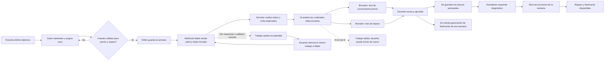

# Implementación del RPA educativo semanal

**Proyecto:** preparación de conocimiento previo, repaso y flashcards por semana
**Fecha de corte:** 1 de noviembre de 2026
**Estado:** implementación lista para publicar. Make está activo, las variables de producción están configuradas en `main` y el permiso de transacción está aplicado; falta desplegar el commit y hacer el recorrido integral.

## 1. Proceso y oportunidad de automatización

Cada semana, el docente reúne objetivos y materiales, prepara una actividad diagnóstica previa y recursos de repaso, y los publica en el curso. Repetir la selección, extracción de conceptos, redacción inicial y organización de esos recursos consume tiempo y produce formatos distintos.

El sistema conserva la decisión pedagógica en el docente y automatiza el trabajo repetitivo:

1. El docente registra objetivos y carga los materiales de la semana.
2. Marca cada material como **conocimiento previo**, **contenido semanal** y/o **repaso**.
3. Solicita la preparación. La aplicación guarda la semana y envía a Make un identificador de trabajo firmado.
4. Make activa el proceso del servidor. La IA analiza las fuentes seleccionadas y prepara dos borradores: test previo y test de repaso.
5. El docente revisa y aprueba ambos borradores. Después puede pedir flashcards solo para esa semana.
6. El estudiante responde el test previo antes de abrir el contenido semanal. Es diagnóstico: no exige nota mínima. Al terminar las lecciones puede acceder al repaso y a las flashcards disponibles.

**Clasificación:** es automatización de un proceso manual orquestada con una plataforma low-code (Make) y servicios de IA. No es un robot que imita clics en pantalla; para el alcance académico, el flujo documenta claramente el proceso repetitivo, las reglas, la intervención humana y las salidas.

## 2. Propuesta de agente inteligente

**Nombre de trabajo:** asistente de preparación semanal. Su tarea es apoyar al docente a partir de las fuentes de esa semana; no publica contenido por cuenta propia.

- **Entradas:** objetivos de aprendizaje y materiales de texto/PDF que el docente etiquetó para conocimiento previo, contenido semanal o repaso.
- **Acciones:** ordenar los conceptos de los materiales, preparar cinco preguntas de opción única para el diagnóstico y cinco para el repaso, y señalar ambas salidas como borradores.
- **Salidas:** dos formularios semanales que el docente puede revisar y aprobar; después, una solicitud separada para generar flashcards del tomo.
- **Reglas:** usa solo las fuentes seleccionadas, ignora instrucciones embebidas en los documentos, no completa información ausente con hechos inventados, no publica sin aprobación y el test previo registra diagnóstico sin exigir nota mínima.
- **Control humano:** el docente comprueba la pertinencia de preguntas y respuestas antes de guardar los bancos; puede corregir o rechazar el contenido desde los controles existentes de bancos y flashcards.

## 3. Correspondencia con el Avance 4 (semana 13)

| Requisito de la evaluación                                  | Evidencia de este proyecto                                                                                   |
| ----------------------------------------------------------- | ------------------------------------------------------------------------------------------------------------ |
| Identificación de procesos repetitivos                      | Selección semanal de fuentes, extracción de conceptos, preparación inicial de tests y flashcards             |
| Diseño del flujo automatizado                               | Diagrama Mermaid y estados persistidos del trabajo: en cola, procesando, listo, aprobado o fallido           |
| Propuesta de agente inteligente                             | Asistente de preparación semanal con entradas, tareas, salidas, límites y aprobación humana definidos arriba |
| Automatización mediante Power Automate, Zapier, Make u otro | Escenario Make con webhook de entrada y acción HTTP al endpoint firmado de la aplicación                     |
| Diagrama de flujo                                           | Sección 4 y bocetos adjuntos en la carpeta de diagramas                                                      |
| Prototipo o simulación                                      | Interfaz del editor docente, panel de espera animado y tarjetas con borradores revisables                    |

El avance asigna 25% a la identificación del proceso, 35% al diseño, 20% a la integración de IA/agentes y 20% a la presentación. La solución deja una evidencia concreta para cada criterio; la demostración de ejecución real se completa al habilitar la conexión de producción.

## 4. Diagrama del flujo

Make solo recibe el ID del trabajo, la URL del callback y una credencial temporal HMAC. Los documentos y su texto permanecen en la aplicación; el callback recupera el trabajo y aplica control de duplicados. Las preguntas generadas quedan en borrador hasta la aprobación del docente.

## 5. Plan por etapas y avance

| Etapa                         | Trabajo                                                                                       | Entregable / aceptación                                                                    | Estado                                                                  |
| ----------------------------- | --------------------------------------------------------------------------------------------- | ------------------------------------------------------------------------------------------ | ----------------------------------------------------------------------- |
| 1. Alcance y proceso          | Identificar entradas, tareas repetitivas, decisiones docentes y salidas                       | Flujo descrito; roles y reglas acordados                                                   | Hecho                                                                   |
| 2. Datos semanales            | Guardar objetivos, etiquetas de materiales, bancos previos por tomo y resultado diagnóstico   | Migraciones y consultas para test previo semanal                                           | Implementado; requiere migración al desplegar                           |
| 3. Interfaz docente           | Editor semanal con objetivos, cargas, etiquetas, animación explicativa y panel de espera      | El docente configura y solicita el proceso por semana                                      | Implementado                                                            |
| 4. Orquestación low-code      | Webhook de Make, control de estado, token temporal y callback idempotente                     | Make activa el proceso sin recibir los documentos                                          | Escenario activo; variables configuradas para `main`                     |
| 5. Generación inteligente     | Crear borradores previo y repaso con los materiales que corresponden a cada uno               | Dos borradores visibles para revisión                                                      | Implementado; depende de credenciales y prueba de Bedrock en el entorno |
| 6. Revisión y flashcards      | Aprobar bancos, pedir flashcards de una semana específica y consultar su estado               | No se publican borradores automáticamente; el panel detecta cuándo el mazo pasa a revisión | Implementado                                                            |
| 7. Experiencia del estudiante | Test previo sin corte de nota, acceso secuencial al contenido y repaso al completar lecciones | El test registra diagnóstico antes de estudiar                                             | Implementado                                                            |
| 8. Evidencia y liberación     | Harness rápido, informe, despliegue y recorrido con una semana real                           | Evidencias de escenario, ejecución Make, aprobación y vista estudiante                     | Harness e informe listos; despliegue y prueba integral pendientes        |

## 6. Alcance técnico implementado

- **Editor docente:** objetivos de aprendizaje por tomo; propósitos por material; selección de semana; carga/extracción de PDF; panel “Ver cómo funciona” y espera animada con respeto a `prefers-reduced-motion`.
- **Recuperación del trabajo:** al volver a abrir la semana, el editor recupera el último trabajo del docente para ese curso y tomo, incluidos borradores listos, errores y procesos pendientes. La referencia expira junto con el trabajo en 24 horas.
- **Configuración de entorno:** `.env.example` documenta los nombres sin valores; Docker Compose los entrega al servidor web local y `amplify.yml` los expone al runtime SSR.
- **Make:** escenario `EdTech - recursos semanales` con webhook de entrada y módulo HTTP al callback de la aplicación. Se eligió porque el flujo ya usa webhook y HTTP, y permite mantener la automatización visible para la demostración del curso.
- **IA:** crea bancos `CONOCIMIENTO_PREVIO_TOMO` y `REFUERZO` desde sus respectivas fuentes etiquetadas.
- **Aprobación humana:** el docente ve las preguntas y respuestas y debe aprobarlas antes de guardar los bancos.
- **Recuperación del proceso:** la llamada de Make toma un bloqueo de tres minutos; si el callback se interrumpe, el docente puede reenviar el mismo trabajo luego de vencer el bloqueo, sin generar un trabajo duplicado. El reenvío tiene una espera mínima de un minuto.
- **Recuperación de aprobación:** se usa un bloqueo temporal de tres minutos para evitar aprobaciones simultáneas. Si falla la escritura, el trabajo vuelve a quedar disponible para reintentar; si el servidor se interrumpe, el docente puede reanudarlo al vencer el bloqueo.
- **Flashcards:** se generan después de aprobar los tests, a partir de los materiales de contenido semanal/repaso y las lecciones; la solicitud y la regeneración se limitan al tomo seleccionado.
- **Estudiante:** el test previo no exige nota mínima y registra un diagnóstico. Las lecciones siguen el test; tests de repaso y flashcards requieren terminar las lecciones semanales, tanto desde el mapa como al abrir sus rutas directamente. Enrollment valida también el inicio de intentos y el endpoint que marca lecciones completadas; la composición Lambda registra el manejador de estado del test semanal.
- **Persistencia y privacidad:** los adaptadores DynamoDB y PostgreSQL guardan objetivos, etiquetas y texto extraído; el texto fuente queda disponible solo en la vista docente, y no se incluye en la vista pública del curso ni se envía a Make.
- **Permisos de persistencia:** el rol SSR de Amplify requiere operaciones de lectura/escritura y transacciones en la tabla de control; el permiso `dynamodb:TransactWriteItems` queda limitado a esa tabla para guardar atómicamente el trabajo y el puntero de recuperación.
- **Seguridad y resiliencia:** autenticación docente con MFA, callback con firma HMAC de vigencia limitada y URL de callback construida desde `APP_URL` del servidor, acceso del trabajo ligado al docente, estado y puntero del último trabajo guardados en una transacción, expiración de lecturas luego de 24 horas, limpieza del texto temporal del trabajo tras generar y tolerancia a reintentos duplicados. Si Make rechaza el trabajo, el estado queda fallido y se elimina ese texto temporal.

### Verificación de código

El harness corto se ejecuta con `bun run weekly-rpa:harness`. Tras añadir las comprobaciones de que las entregas iniciales y los reintentos usan el origen de `APP_URL`, pasó **49/49 comprobaciones estáticas**. Cubre recuperación de borradores, objetivos obligatorios, reintentos Make, persistencia atómica, seguridad HMAC, expiración, alias DynamoDB, permisos acotados, variables del runtime, restricciones de acceso directo y registro de la consulta semanal en la Lambda. TypeScript de `apps/web`, `services/catalog` y `services/enrollment-progress`, ESLint de los módulos principales y `git diff --check` pasaron en la revisión anterior al último ajuste. En la verificación anterior pasaron **18 pruebas dirigidas** de `gestionar-intento.handler.test.ts` y `completar-leccion.handler.test.ts`. No se pudo comprobar `terraform fmt` porque el CLI de Terraform no está instalado. Estas comprobaciones no reemplazan la prueba de extremo a extremo que requiere habilitar Make en producción.

El comando de seguimiento `bun run weekly-rpa:preflight` es de solo lectura. Comprueba variables locales sin mostrarlas, integridad de los dos ZIP, variables por nombre en Amplify, publicación del código e IAM mediante simulación de política. En la última ejecución pasaron configuración local y ZIPs; faltan las variables de Make en Amplify, publicar los cambios locales y permitir `dynamodb:TransactWriteItems`. La activación del escenario y su ejecución exitosa se confirman manualmente en Make. El preflight elimina `AWS_ENDPOINT_URL*` del proceso AWS hijo para que el `.env` local de LocalStack no desvíe las consultas del perfil de producción.

## 7. Esfuerzo, costo y operación

El código, la interfaz y el escenario de Make son un prototipo académico. El Make conectado mostró el plan Free con un límite de 1,000 créditos mensuales y hasta dos escenarios activos; el flujo usa un escenario. El consumo real depende de cuántas semanas se procesen y de las operaciones del escenario, por lo que hay que revisar el contador de Make durante la demostración.

La generación con Bedrock puede tener costo variable según modelo y volumen de texto. No se fija un importe porque depende de la configuración de la cuenta y del modelo activo. Para la prueba del curso, usar una semana, texto acotado y una sola ejecución evita consumo innecesario. Antes de uso recurrente, registrar costo por semana y definir un tope mensual.

**Operación prevista:** el docente inicia la generación; el servidor crea y expira el trabajo; Make enruta el evento; IA produce borradores; el docente aprueba; el estudiante consume los recursos. Si Make o la IA fallan, el estado reporta error y el docente vuelve a iniciar la generación.

## 8. Evidencias para adjuntar al informe

El repositorio conserva bocetos del editor, el flujo, el comparativo de plataformas y los estados animados:

- [Editor docente semanal](../diagramas/rpa-bocetos/boceto-editor-semanal-docente.png)
- [Diagrama del flujo RPA/low-code](../diagramas/rpa-bocetos/flujo-semanal-rpa-lowcode.png)
- [Alternativas de plataforma](../diagramas/rpa-bocetos/opciones-make-power-automate-power-apps.png)
- [Animación de explicación del proceso](../diagramas/rpa-bocetos/animacion-explicativa-flujo.png)
- [Animación de espera y análisis](../diagramas/rpa-bocetos/animacion-espera-analisis.png)
- [Vista de recursos listos](../diagramas/rpa-bocetos/animacion-recursos-listos.png)

Para cerrar la evidencia de ejecución real, capturar: (1) escenario Make con módulos y estado activo, (2) una ejecución exitosa, (3) borradores y aprobación en el editor docente, y (4) test previo y desbloqueo de la semana en la cuenta estudiante. No adjuntar webhook, tokens, documentos privados ni secretos.

## 9. Publicación y diagnóstico pendientes

En Amplify `main` ya existen `MAKE_WEEKLY_RESOURCES_WEBHOOK_URL` y `EDTECH_WEEKLY_JOB_SECRET`; las variables tienen valores para la rama principal y usan marcadores no funcionales en el alcance base, sin exponer el webhook ni el secreto a otras ramas. El preflight comprueba sus nombres sin leer ni imprimir valores. El escenario **EdTech - recursos semanales** está activo y el webhook llama al callback mediante `POST` con `application/json`, enviando `jobId` y token HMAC temporal; Make no recibe documentos fuente.

El rol SSR de Amplify es `edtech-lowcost-amplify-compute`. La política inline activa ya permite `dynamodb:TransactWriteItems` únicamente sobre `edtech-lowcost-control`; la simulación IAM devuelve `allowed` para ese ARN. El Terraform del entorno low-cost también declara el permiso acotado.

El código RPA sigue pendiente de publicación. Antes del cambio, el último build exitoso de Amplify era el job 14 del commit `fbb6cdb`, que respondía 404 al callback nuevo. Los ZIP locales actuales para `catalog` y `enrollment-progress` deben regenerarse después del commit y subir a las funciones Lambda `$LATEST`; ninguna función usa alias. No se ha hecho todavía una ejecución integral posterior a esos despliegues.

El próximo corte de publicación es: (1) publicar el commit RPA en `main` y esperar el build de Amplify; (2) compilar y subir los ZIP actualizados a las Lambdas de `catalog` y `enrollment-progress`; (3) ejecutar `bun run weekly-rpa:preflight`; y (4) probar una sola semana con materiales acotados, revisar y aprobar los borradores, y comprobar el acceso del estudiante. Esa última prueba usa Bedrock y escribe en producción, así que se ejecutará de forma controlada después de verificar los despliegues.

Para producción recurrente conviene mover `EDTECH_WEEKLY_JOB_SECRET` a Secrets Manager y adaptar su lectura; las variables directas de Amplify corresponden al prototipo del curso.
